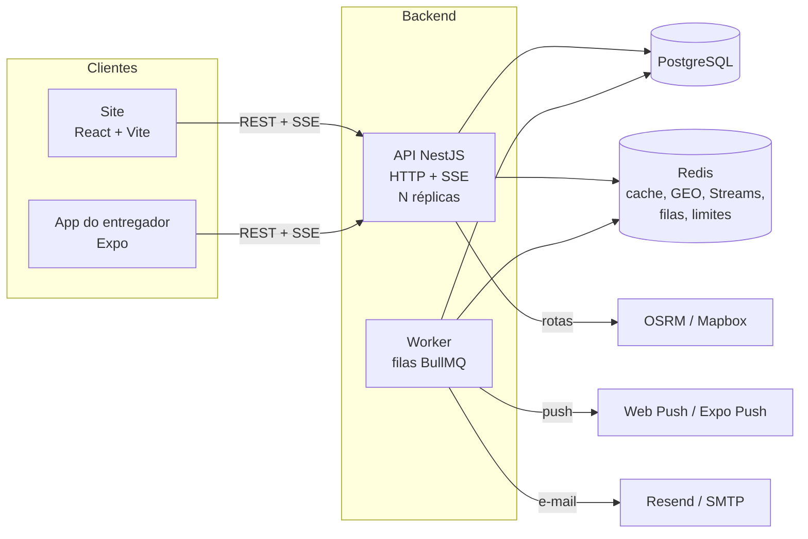

# Arquitetura

## Peças

| Peça | Papel |
|---|---|
| **API** (`APP_ROLE=api`) | Rotas REST sob `/api` e o stream SSE `/api/events/stream`. Não guarda estado na memória: dá para rodar várias réplicas atrás de um balanceador |
| **Worker** (`APP_ROLE=worker`) | Processa as filas: `dispatch` (procurar entregador, expirar oferta), `orders` (pronto automático), `push` e `mail`. Marca presença no Redis a cada 10 s (aparece em `/api/health`) |
| **PostgreSQL** | Dados de negócio. Esquema versionado em migrations (TypeORM) |
| **Redis** | Cache de autenticação (60 s), posição dos entregadores (GEO), ofertas, eventos por pessoa (Streams) e pub/sub entre réplicas, filas do BullMQ, tokens de recuperação de senha, contadores do limite de requisições |

Em desenvolvimento, `APP_ROLE=all` roda API e worker no mesmo processo.

## Tempo real

1. Cada mudança relevante gera um evento para as pessoas envolvidas (cliente, equipe da loja,
   entregador, admins), cada uma recebendo **a sua visão** do pedido.
2. O evento vai para um Redis Stream da pessoa e é publicado no pub/sub.
3. A réplica que segura a conexão SSE da pessoa entrega na hora. Ao reconectar com `Last-Event-ID`,
   a API reenvia o que se perdeu.

A lista de eventos está no [README da API](../README.md#tempo-real).

## Notificações e e-mail

`NotificationsService.notify` grava na central (com lido/não lido), manda pelo SSE e coloca um
trabalho na fila `push`. O worker envia Web Push (VAPID) para navegadores e Expo Push para
celulares. E-mails seguem o mesmo caminho pela fila `mail`, com o provedor escolhido por variável
(`log`, `resend` ou `smtp`). A requisição nunca espera um serviço de fora.

## Decisões

| Decisão | Por quê |
|---|---|
| SSE em vez de WebSocket | Só o servidor empurra dados; SSE atravessa proxies, reconecta sozinho e retoma com `Last-Event-ID` |
| Redis para posição dos entregadores | `GEOSEARCH` acha os mais perto da loja em milissegundos, e a presença expira sozinha (TTL) |
| Filas para despacho, push e e-mail | Tentativas com espera crescente, nada se perde se uma réplica cair, a API responde rápido |
| Limite de requisições no Redis | Vale somado entre réplicas; se o Redis cair, deixa passar em vez de derrubar a API |
| Token de senha só como hash | Quem lê o Redis não consegue usar o link; validade e uso único sem tabela nova |
| Preço calculado no servidor | O site nunca define valor; o pedido guarda a cópia dos itens como estavam |
| Listas virtualizadas no site | Cardápios, históricos e tabelas longas continuam leves no celular |
