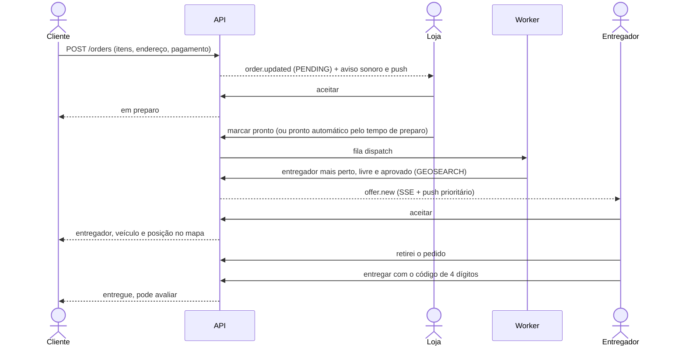

# Fluxos

## Pedido do começo ao fim



Estados e transições:

```
PENDING ─aceita→ PREPARING ─pronto→ READY ─retira→ PICKED_UP ─código→ DELIVERED
   ├─loja recusa→ REJECTED
   └─cliente cancela→ CANCELLED   (loja cancela em PREPARING/READY; admin em qualquer etapa ativa)
```

Toda mudança entra na linha do tempo do pedido, com autor e nota ("Automático" quando foi o sistema).

## Despacho

1. Pedido em `READY` entra na fila `dispatch`.
2. O worker busca entregadores online perto da loja, livres, aprovados e que ainda não recusaram
   este pedido. Cada entregador recebe **uma oferta por vez**.
3. A oferta vale `DISPATCH_OFFER_TTL_SEC` (25 s). Recusou ou expirou: vai para o próximo.
4. Sem ninguém: tenta de novo a cada `DISPATCH_RETRY_DELAY_MS`. Depois de `DISPATCH_ALERT_AFTER`
   rodadas, os admins são avisados (a busca continua).
5. O admin pode designar ou trocar o entregador até a retirada. Se o entregador desistir, o pedido
   volta para a busca e a desistência entra na linha do tempo com o motivo.

## Horário de funcionamento

A loja recebe pedidos quando **o botão do painel está ligado e está dentro do horário** (se houver
horário). Faixas por dia da semana, no fuso da loja; fechamento menor que a abertura passa da
meia-noite; `00:00`–`00:00` é o dia todo. A vitrine devolve `openNow`, `opensAt` e `closesAt`, e
lojas fechadas vão para o fim da lista. Regra em `src/modules/stores/opening-hours.ts`, coberta por
testes de unidade.

## Esqueci minha senha

```mermaid
sequenceDiagram
  actor P as Pessoa
  participant S as Site / App
  participant API
  participant W as Worker
  participant M as Provedor de e-mail

  P->>S: e-mail em "Esqueci minha senha"
  S->>API: POST /auth/forgot-password
  API-->>S: 202, mesma resposta exista a conta ou não
  API->>W: fila mail (link com token; Redis guarda só o hash, 60 min)
  W->>M: envia
  P->>S: abre /redefinir-senha/<token>
  S->>API: GET /auth/reset-password/:token (e-mail mascarado)
  P->>S: senha nova
  S->>API: POST /auth/reset-password
  API-->>S: sessão nova; todas as outras caem; aviso de "senha alterada" por e-mail
```

O link vale uma vez; pedir outro invalida o anterior. Conta bloqueada não recupera acesso por aqui.

## Convite para a equipe da loja

1. Dono (ou gerente, para atendentes) gera o convite em **Loja → Equipe**: sai um link
   `/convite/<token>` válido por 7 dias. E-mail que já é de cliente ou entregador é recusado com o motivo.
2. Quem **não tem conta** abre o link, cria a conta (já como lojista, com o e-mail do convite) e cai
   direto no kanban da loja.
3. Quem **já é lojista** recebe o convite também na central de notificações; abre o link, entra com
   aquele e-mail e aceita.
4. Quem abre o link logado com **outra conta** vê o aviso e a opção de trocar de conta.

## Moderação

| Ação do admin | Efeito |
|---|---|
| Aprovar loja ou entregador | A pessoa é avisada; a loja pode abrir, o entregador pode ficar online |
| Pedir ajuste ao entregador | Continua em análise e vê o que corrigir |
| Suspender loja | Sai da vitrine na hora, fecha e a equipe vê o motivo. Reativar não abre sozinha |
| Tirar produto do ar | Some do cardápio e a loja não consegue reativar |
| Bloquear conta | Perde o acesso em todas as sessões; o login mostra o motivo |
| Tratar denúncia | Resolver (com ou sem punição) ou arquivar; quem denunciou recebe a resposta |

Tudo vai para a **auditoria**, com autor, alvo e motivo.
